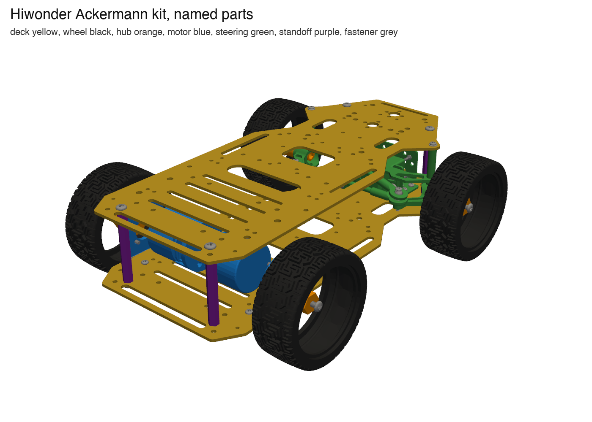
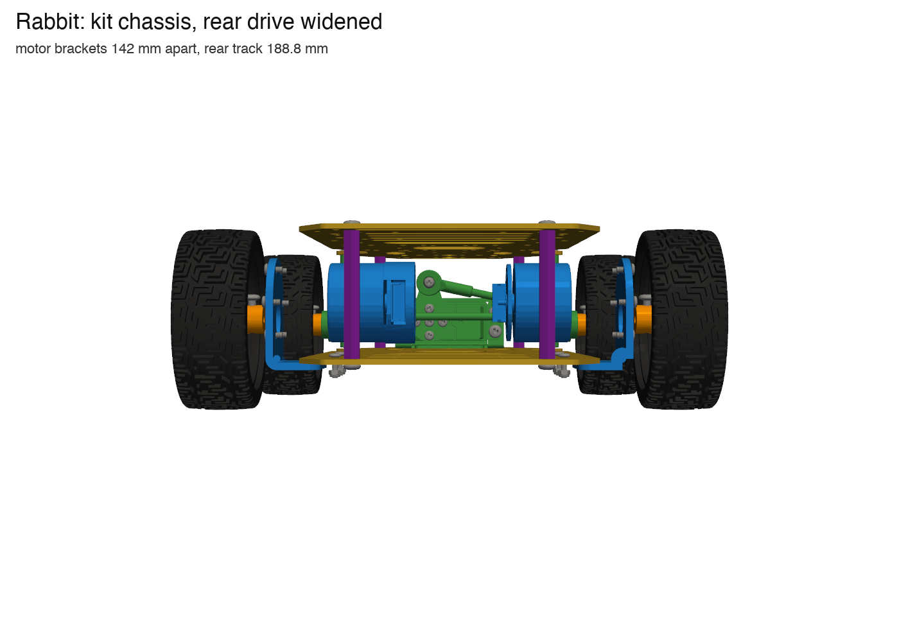

# Rabbit robot CAD

One assembly of the whole robot, built in code so that an agent can read, change, measure and check it. It starts from the Hiwonder kit model and grows part by part: drive, mounts (`cad/brackets`), boards (`pcb/`).

## Design loop

```bash
run() { uv run --project model python cad/robot/run.py "$@"; }   # zsh and bash
nohup uv run --project model python cad/robot/serve.py > data/cad/robot/serve.log 2>&1 &   # once: live viewer, http://127.0.0.1:8765
run build                                  # ~1 s from cache (+3 s Python start); the viewer reloads by itself
run render rear,iso_rear --name drive --focus drive_ deck_1 --hide fastener --ghost deck_3 --title "..."
run measure drive_maxon_left deck_1       # exact min distance, closest points, per-axis gaps
run info wheel_rear_left                  # exact box and volume
run list motor                            # names by substring or group
run check                                 # overlaps of our parts with everything -> data/cad/robot/fit_report.json (~3 s; --exact for OCCT booleans)
run export                                # exact STEP (named tree, colours) + GLB, ~2 min
RABBIT_DRIVE=kit run build                # the kit motors instead of the maxon drive (default: maxon)
```

1. **Edit** a part or the assembly in Python (`robot.py` `new_parts()`, `removed()`, or a part script).
2. **Build**: kit parts come from the BREP cache with names and boxes from `chassis_parts.json`; meshes are cached per part by content hash (`data/cad/robot/mesh/`), so only changed parts are tessellated. Screws and tyres are drawn as cylinders.
3. **Look**: the owner keeps the viewer open (orbit, groups, part list, click for size, Shift-click two points for a distance, section plane, views); the agent renders PNGs (`data/cad/robot/renders/`) and reads them.
4. **Measure and check**: `measure` and `info` use the exact B-rep; `check` intersects the cached meshes with manifold3d (0.3 mm mesh tolerance, 1 mm³ threshold, OCCT fallback when a mesh is not watertight) and caches every pair by content, because an OCCT boolean against a threaded kit screw takes ~60 s the first time. Typical times on the M-series Mac: build 2 s, render 4 s, check 3–6 s, measure/info 5 s (mostly Python start), export 2 min.
5. **Record**: curated renders go to `cad/robot/renders/`, numbers to the docs.

Other scripts: `chassis.py` (re)classifies the kit and rewrites `chassis_parts.json`, `jev_labels.py` asks Jev for a second opinion on the names, `render_chassis.py` renders the named groups.

Frame: `model/chassis.step`, mm. Forward is −Y, the robot's left is +X, up is +Z; centreline x = 2.48, front axle y = −88.4, rear axle y = 83.15, deck 1 top z = 29.12.

## Tool choice

**build123d** (Python on the OpenCASCADE kernel), already used in `cad/brackets` and `cad/drive`, stays the source of truth. Compared on 2026-10-10 for agent work, free or cheap, with an independent second review (facts checked on the web the same day):

| Tool | Agent fit | Exact B-rep / STEP | Cost | Role here |
|---|---|---|---|---|
| build123d + build123d MCP | Plain Python, diffable, headless; MCP adds measure, render, fit and printability loops | Yes; STEP AP214 with names, colours and tree; GLB with named nodes | Free | **Source of truth** |
| CadQuery | Same kernel; assembly STEP loses names unless flattened | Yes | Free | No reason to switch |
| FreeCAD 1.1 (Mar 2026, native arm64) | Python API, state in a GUI document; community MCP only | Yes, reads names/colours/tree, glTF import | Free | **Owner's editor**: sections, measuring, manual edits |
| CAD Assistant (OpenCascade) | — | Reads STEP/glTF/BREP with the tree | Free | **Owner's quick viewer** |
| Fusion | Official Fusion MCP (Autodesk + Anthropic, Apr 2026), needs the app running | Round trip with build123d is STEP only, parameters lost | Personal licence free, non-commercial | Optional hand sketching |
| Shapr3D | No API, scripting or MCP; AI = in-app Generative Render and a help chatbot | Imports STEP/X_T; free plan exports only basic 3MF/STL, STEP export is Pro ($299/yr) | Free plan: 2 projects | Viewer at best; dead end for agents |
| Onshape | REST API, FeatureScript; no official MCP | Yes | Free plan = public documents; private from $1,500/yr | No |
| Zoo (KCL) | Text CAD + MCP | STEP import read-only/experimental | Metered ($0.50/min API) | Watch |
| OpenSCAD, SolveSpace, Blender | Mesh or no scripting | No STEP import (OpenSCAD), import-only (Blender) | Free | No |
| PartCAD | YAML assemblies over build123d/STEP/KiCad, agent skills; exports URDF/SDF/MJCF for simulation | Yes | Free (Apache-2.0) | Try on `cad/drive` before adopting |
| KiCad 9 | `kicad-cli pcb export step` | Board STEP with refdes names | Free | Boards into this assembly |

Formats: STEP AP214 (named assembly tree, colours) for exchange and for the owner's apps; GLB for the browser and the HUD (three.js); BREP cache for speed; 3MF only for printing (names and colours do not survive a round trip). Assembly STEP/GLB live in `data/cad/robot/` (gitignored); part scripts, small part STEP/3MF, JSON manifests and renders are committed. `model/chassis.step` is 68 MB in plain git (GitHub warns at 50 MiB): don't add more files like it.

## The kit as named parts

The kit STEP labels its 134 solids `Part_1`…`Part_134`; those are the stable ids (`kit_id`). `chassis.py` gives each a name from size, volume and position (`chassis_parts.json`): 2 decks (`deck_1` lower, `deck_2` upper), 4 wheels, 10 hub parts (hubs, front stub axles, bearings), 10 motor parts (gearbox with its L bracket, can, encoder cap and board, connector), 17 steering parts (servo, posts, knuckles, links), 4 standoffs, 87 fasteners. The import is cached as BREP in `data/cad/kit/<STEP hash>-<build123d version>/`. Jev (TypeSafe, `jev_labels.py`) agrees on every large part; on small fasteners it guesses from position and is not reliable, so the geometric rules stay authoritative.



## Changes to the kit

| Change | Why | Where |
|---|---|---|
| Rear drive moved out 10.7 mm per side: motor brackets 142 mm apart, rear track 188.8 mm | The robot was widened for the Pololu 37D (C16, M18) | `robot.py` `WIDEN` |
| Rear hubs get their Ø6 bore | The kit model's hub is solid apart from the set-screw hole | `robot.py` `HUB_BORE_D` |
| Rear drive: maxon ECX FLAT 22 L HT 18 V + GPX 22 UP 2-stage + ENX 22 MILE on a 4 mm adapter plate per side (default; `RABBIT_DRIVE=kit` shows the kit motors) | Chosen drive (Q41); modelled from catalogue pp. 216, 355, 406 in `parts/maxon.py` | `robot.py` `maxon_drives()` |
| Third floor: `deck_3` is a copy of the kit's upper plate (now `deck_2`) on four more 50 mm standoffs (`standoff_*_upper`); decks are 52 mm apart bottom to bottom, tops at z = 29.12 / 81.12 / 133.12; the kit's top screws move up to deck 3 | The robot has three identical plates on identical standoffs (owner, 2026-10-10) | `robot.py` `FLOOR_PITCH` |

The 2.0 plan in `cad/brackets` (PCB as deck 2 on 45 mm brass columns, M1) is a future layout; this assembly models the robot as it is now.



## Next

From the second review, in order:
1. One assembly: `cad/robot` becomes the composer that `cad/brackets` and `cad/drive` plug into (decks at 45 + 45 mm, PCB as deck 2, mounts, drive options), with a nested tree (`rabbit/chassis/...`, `rabbit/rear_drive_left/...`); `cad/` as a package of the `model` uv project instead of `sys.path` imports.
2. Commit the hand-checked `Part_N → name` map and replace run-time classification with a test that the map is complete and each part's volume and box still match.
3. Fit checks as pytest (overlap > 0.5 mm³ fails), runnable on CI from the cached BREPs.
4. Boards via `kicad-cli pcb export step`; maker STEPs (maxon, Faulhaber, Jetson, ZED, lidar) in `data/cad/makers/` with a manifest of source URL, revision and placement.
5. Colour by origin (kit / printed / machined / bought) in the viewer exports.

## maxon drive as placed

`parts/maxon.py` models the drive from the maxon Product Range 2026/27 drawings, and the adapter plate:

- **Kit bracket, measured** on `motor_bracket_left`: 3 mm plate, 6 × Ø3.2 on Ø31 at 0°, 60° … (one pair horizontal), pattern centre 7 mm above a Ø15 hole whose centre (y 83.156, z 44.457) is the wheel axis.
- **Adapter plate**, 4 mm aluminium, Ø37 disc on the kit pattern: Ø15 bore for the gearhead pilot, 4 × M3 tapped on the upper kit holes (the lower two would leave 1 mm to the bore, so their kit screws are dropped), 6 × M2 clearance with Ø4.2 × 1.5 counterbores for DIN 7984 M2 × 6 low heads, so the kit bracket is not modified. The counterbores reach the bore edge (both at r = 7.5) on the outer 1.5 mm. Thinnest wall elsewhere 0.9 mm (M2 clearance to M3 tap).
- **Fit** (`run.py check`, `measure`): no overlaps; motor body 4.34 mm above deck 1 and 17.7 mm under deck 2; 33.6 mm between the two motors' rear ends; Hall-board tab up. The shaft (21 mm from the gearhead flange) ends 15 mm past the bracket's outer face, 1.8 mm short of the kit motor's shaft; the hub's M4 set screw lands on the flat.
